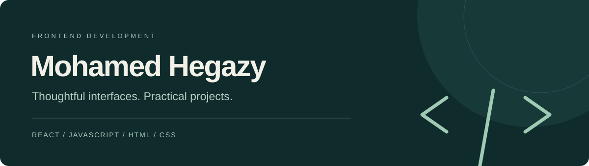

  

## Hi, I'm Mohamed

Software engineering student focused on frontend development with **React, JavaScript, HTML and CSS**. These projects explore responsive interfaces, validated forms, browser persistence and public APIs.

### Selected projects

| Project | Experience | Links |
| :--- | :--- | :--- |
| **Souqna / سوقنا** | Arabic RTL marketplace demo with product details, comparison, favorites and a saved cart. | [Try the site](https://mohamed-hegazy1.github.io/souqna/) · [Code](https://github.com/mohamed-hegazy1/souqna) |
| **Desk Supply** | A calm, responsive storefront. Combined filters, sorting and a saved demo bag. | [Try the site](https://mohamed-hegazy1.github.io/desk-supply-demo/) · [Code](https://github.com/mohamed-hegazy1/desk-supply-demo) |
| **Applyboard** | An application tracker with validated forms, status filters, local persistence and undo. | [Try the site](https://mohamed-hegazy1.github.io/applyboard/) · [Code](https://github.com/mohamed-hegazy1/applyboard) |
| **Repo Lens** | Explore public GitHub repositories with pagination, filters and cancellable API requests. | [Try the site](https://mohamed-hegazy1.github.io/repo-lens/) · [Code](https://github.com/mohamed-hegazy1/repo-lens) |

### Frontend toolkit

`React` · `JavaScript` · `HTML` · `CSS` · `Tailwind CSS` · `Bootstrap`

### About this portfolio

These are learning projects prepared with AI assistance, not client work or employment history. They include sample storefront data and browser-local tools, not real sales or application services. Public technical notes and Arabic code walkthroughs support review and practice.

Existing university coursework is kept separate. No invented clients, experience or contribution history.
